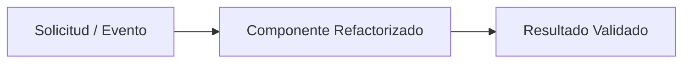

Bitácora de ingeniería de prompts y contexto — Semana 1
Estudiante: Alvaro
Fecha de actualización: 2026-11-17
Estado: ambos retos implementados, contrastados con los archivos recibidos del chat limpio y verificados localmente.

1. Preparación y diagnóstico inicial

Preparé el proyecto en week-1/starter-project con uv. Conservé las salidas iniciales en evidencias/01-triaje-inicial.txt y evidencias/02-sla-inicial.txt.
El motor clasificaba INC-1002 e INC-1009 como P0 por contener “hoy”, mientras INC-1007 quedaba en P3 pese a describir exposición de facturas entre organizaciones.
La demostración de SLA contabilizó 3.840 minutos entre el viernes a las 17:00 y el lunes a las 09:00. Para un P2 deben ser 120 minutos hábiles. Conservé este resultado como línea base; la corrección se documenta en la sección 2.

1.1 Diagnóstico del prompt pobre

El prompt original decía: “El archivo triage_rules.py funciona mal con algunos tickets del JSON. Agrégale el equipo recomendado y una clave para duplicados, y no pongas P0 cuando no sea urgente.”
Identifiqué cinco problemas:
1. No define impacto ni alcance para distinguir P0 de una solicitud individual.
2. Utiliza “urgente” como criterio ambiguo y una restricción negativa sin regla positiva equivalente.
3. No enumera equipos válidos ni sus responsabilidades.
4. No establece el formato ni el significado de la clave de duplicados.
5. No aporta ejemplos completos ni criterios de aceptación verificables.

1.2 Consultas independientes y revisión de contexto

Realicé consultas iniciales en chats separados y después pedí corregir cada respuesta usando los reportes completos. Las respuestas iniciales hablaban de extractos truncados y describían incorrectamente la exportación como bloqueada. No puedo atribuir ese error solamente al modelo: también debía comprobar qué contexto recibió cada conversación.
Identificación confirmada de las respuestas corregidas:
respuesta_chat_1_corregida.md: GPT-5.6 Sol con razonamiento Alto.
respuesta_chat_2_corregida.md: GPT-6 Instantánea.
Ambos coincidieron en 8 de 10 severidades, todos los componentes y equipos, y las dos parejas de duplicados. Sol propuso P0 para INC-1007 y P3 para INC-1009; Instantánea propuso P1 y P2, respectivamente.
No interpreté la coincidencia como certeza. Revisé cada decisión contra el JSON y fijé una política explícita antes de solicitar código.
Pedí justificaciones breves y comprobables. No registré razonamiento interno privado ni afirmé haber obtenido trazas Chain-of-Thought dentro de etiquetas analysis.

1.3 Política adoptada y prompt de implementación

Adopté P0 para la exposición de facturas entre organizaciones, P2 para la exportación lenta pero exitosa y P1 para INC-1006 por el alcance de su reporte. Estas son decisiones del ejercicio, no una tabla oficial suministrada por el docente.
El prompt estructurado quedó en la conversación de trabajo: role, context con lsp_context, domain_rules, examples, constraints y task. Incluyó como ejemplos la pareja de pagos P0/P1 con la misma clave, los dos casos de latencia, la exposición entre organizaciones y la exportación exitosa.
Adjunté los reportes completos y models.py porque la extracción AST omite imports, alias y decoradores. La respuesta recibida está preservada en evidencias/respuesta_refactor_triaje.md.
Conservé el prompt de referencia estructurado y su contexto en PROMPT_REFACTOR_TRIAJE.md. Es la versión documental de las instrucciones proporcionadas en esta conversación, no una exportación literal del mensaje enviado al chat externo. La respuesta externa sí está disponible como evidencia.

1.4 Revisión e implementación local

Revisé la propuesta antes de ejecutarla. La respuesta tenía fragmentos incompletos al comienzo y versiones completas de ambos archivos al final. Utilicé estas últimas, validé su sintaxis y conservé los originales en evidencias/codigo-original.
Actualicé models.py y triage_rules.py. El clasificador decide por el texto, no por el ID. La tabla EXPECTED se usa exclusivamente para verificar los resultados.
Corregí una generalización de la propuesta: los errores de pago sin código 502 ya no reciben una clave que afirme HTTP 502. Para esos casos utilicé payment_unavailable.
También aclaré que el P3 de respaldo para texto desconocido es provisional y exige revisión manual. No constituye evidencia de impacto bajo.

1.5 Verificación técnica ejecutada

Ejecuté con UV_CACHE_DIR=/tmp/incidentops-uv-cache:
uv run --offline python -m src.triage_rules
Resultado: código de salida 0. Pasaron los 10 casos, los componentes, equipos, claves esperadas, las dos parejas de duplicados y las cuatro regresiones incorporadas. Evidencia: 06-triaje-verificado.txt.

Ejecuté:
uv run --offline python -m unittest discover -s tests -v
Resultado: código de salida 0, seis pruebas adicionales correctas. Verifiqué normalización de acentos, mayúsculas y espacios en los 10 reportes; independencia del ID; invariancia al agregar urgencia; un pago con error 503; revisión manual de casos desconocidos; e importación de los módulos de repositorio y SLA. Evidencia: 07-regresiones-triaje.txt.
La importación de SLA comprueba compatibilidad, no corrige ni valida su cálculo de horario hábil.

Resultado final de severidades:
INC-1001 P0; INC-1002 P2; INC-1003 P2; INC-1004 P3; INC-1005 P1; INC-1006 P1; INC-1007 P0; INC-1008 P2; INC-1009 P2; INC-1010 P3.

Limitaciones: el motor sigue siendo heurístico. La búsqueda de expresiones no comprende todas las negaciones, contextos mixtos ni formulaciones del lenguaje natural. Las pruebas no acreditan cobertura universal ni preparación para producción. consistency_ratio permanece por compatibilidad y no representa una confianza medida.

2. Explorar, destilar y ejecutar con contexto limpio: SLA

2.1 Exploración previa al código

Analicé el diseño con el asistente en la conversación de trabajo antes de modificar sla_calculator.py. Comparé resta continua, recorrido minuto a minuto, intersección diaria y cálculo por semanas completas. Elegí intersección diaria por claridad y costo O(D), con memoria O(1). Conservé la exploración en evidencias/09-exploracion-sla.txt.
La resta continua sigue siendo adecuada para P0/P1. Para P2/P3, solo sumé la intersección con [08:00,18:00) de lunes a viernes. No añadí festivos que el enunciado no define.

2.2 Resumen destilado

1. Conservar la firma y las entidades públicas del cálculo de SLA.
2. Para P0/P1 sumar tiempo continuo; para P2/P3 intersectar días laborables con [08:00,18:00).
3. Recorrer días con costo O(D) y memoria O(1); excluir fines de semana, no festivos.
4. Usar datetime sin zona bajo una única hora local de negocio; rechazar fechas con zona e intervalos invertidos.
5. Usar resolved_at como fin cuando exista; de lo contrario, reference_time.
6. Acumular segundos y truncar minutos una sola vez para los campos públicos.
7. Incumplir únicamente cuando el tiempo exacto supera el plazo; la igualdad no incumple.
8. Escalar un incidente no resuelto desde el 75% y mantener el escalamiento al vencer.
9. No escalar cuando status sea RESOLVED o exista resolved_at.
10. Descartar el recorrido minuto a minuto y fórmulas semanales más complejas; verificar bordes y compatibilidad.

2.3 ADR e implementación

Dejé la decisión en docs/adr/002-calculo-sla-horario-habil.md antes de implementar el cambio. Incluí alternativas, contrato temporal, diagrama Mermaid, consecuencias y verificación.
Implementé la función auxiliar _business_seconds, conservé evaluate_sla_status y eliminé la condición que desactivaba el escalamiento al vencer. resolved_at detiene el reloj; un incidente resuelto no escala. La evaluación no modifica el estado ni envía notificaciones.

2.4 Verificación ejecutada

uv run --offline python -m src.sla_calculator
Resultado: 11 casos correctos, código de salida 0. Evidencia: 11-sla-verificado.txt.
Viernes 17:00 a lunes 09:00: 120 minutos.
Viernes 18:30 a lunes 08:30: 30 minutos.
Sábado 10:00 a lunes 08:30: 30 minutos.
Intervalo solo de fin de semana: 0 minutos.
Jornada hábil completa: 600 minutos.
P1 en sábado durante 180 minutos: escalamiento activo.
P2 al 75%: escalamiento activo.
P2 vencido: mantiene escalamiento.
P0 exactamente al límite: no vencido; un segundo después: vencido.
Varios fines de semana: 3.120 minutos hábiles.

uv run --offline python -m unittest discover -s tests -v
Resultado: 18 métodos de prueba correctos, código de salida 0, incluidos los seis del triaje. Las pruebas SLA recorren 40 intervalos adicionales mediante un oráculo independiente minuto a minuto, además de subcasos para todos los umbrales y severidades. Verifiqué acumulación de segundos entre jornadas, fechas inválidas, resolución, límite máximo de fecha y ausencia de mutaciones. Evidencia: 12-pruebas-integrales.txt.

uv run --offline python -m src.incident_repository --records 10000 --iterations 1
Resultado: código de salida 0, 800 incidentes activos encontrados para payments-gateway. La ejecución tardó 11,73 ms en este entorno. Es una prueba de integración, no una comparación de rendimiento ni una corrección de las consultas N+1. Evidencia: 13-integracion-repositorio.txt.

2.5 Ejecución con contexto limpio y contraste final

Después de la exploración y del resumen de diez líneas, utilicé el prompt completo conservado en PROMPT_CHAT_LIMPIO_SLA.md para la fase de contexto limpio. Incorporé los dos archivos recibidos: sla_calculator.py y 002-calculo-sla-horario-habil.md. Conservo sus versiones sin modificar en evidencias/chat-limpio-sla.
La secuencia real incluyó una implementación local previa y después el contraste con la propuesta del chat limpio. No presento la implementación previa como si hubiera sido generada en esa segunda conversación.
La propuesta coincidió con el algoritmo O(D), el horario hábil y el escalamiento persistente. Aportó dos mejoras: acumular timedelta exactos en lugar de segundos de coma flotante y validar únicamente el intervalo efectivo. Cuando existe resolved_at, una reference_time no utilizada no cambia ni invalida el resultado.
Integré esas mejoras y conservé las comprobaciones explícitas de la demostración local, que no desaparecen con python -O. Adapté el import al paquete src del proyecto. El ADR final está redactado en primera persona y recoge esta decisión; el ADR externo original queda preservado como evidencia.

Ejecuté nuevamente el triaje, la demostración SLA, la demostración con optimizaciones y unittest. Todos finalizaron con código 0. La suite final contiene 20 métodos de prueba. Agregué casos de vencimiento por un microsegundo y referencia con zona ignorada cuando existe cierre válido. Evidencias: 18-sla-cierre.txt, 19-pruebas-cierre.txt, 20-triaje-cierre.txt y 21-sla-optimizado.txt.

3. Comparación de modelos y decisiones arquitectónicas

En este ejercicio, el modo de razonamiento detalló diferencias de alcance, pero también propuso P3 para la exportación lenta. El modo Instantánea propuso P2 para ese caso y P1 para la exposición entre organizaciones. Resolví las diferencias mediante política explícita y verificación de datos, no por preferencia automática por un modelo.
Como cambié tanto el modelo como el esfuerzo de razonamiento, esta comparación no aísla el efecto del modo. No medí tiempos de respuesta ni costos, y no puedo afirmar que un modelo fuera indispensable.

Escenario | Paradigma | Justificación
Contabilizar minutos hábiles y umbral del 75% | Código determinista | Resultado reproducible y comprobable, sin costo ni incertidumbre de inferencia.
Explorar casos borde y redactar ADR de consultas SQL | Asistente GenAI en chat | Apoya el diseño previo, sujeto a revisión técnica, sin añadir latencia al sistema en ejecución.
Detectar anomalías numéricas en millones de métricas | ML clásico | Adecuado para patrones estadísticos; exige evaluar precisión, falsos positivos y costo de procesamiento.
Clasificar lenguaje abierto no cubierto por reglas | LLM en tiempo de ejecución | Mayor flexibilidad, con validación de esquema, evaluación, control de costo y latencia y revisión de casos inciertos.

4. Economía de tokens

Mediciones iniciales conservadas en las evidencias 03, 04 y 05. Tokenizador declarado: tiktoken o200k_base.

Símbolo | Estrategia | Caracteres | Tokens | Reducción frente a fuerza bruta
classify_incident_report | Fuerza bruta, 8 archivos | 32718 | 8216 | 0%
classify_incident_report | Búsqueda textual, 2 archivos | 5522 | 1412 | 82,81%
classify_incident_report | Extracción semántica AST | 3987 | 1069 | 86,99%
evaluate_sla_status | Fuerza bruta, 8 archivos | 32718 | 8216 | 0%
evaluate_sla_status | Búsqueda textual, 4 archivos | 24015 | 5820 | 29,16%
evaluate_sla_status | Extracción semántica AST | 4412 | 1133 | 86,21%

El script llama fuerza bruta a los archivos de src, data y docs/adr definidos en sus patrones; no incluye literalmente todo el repositorio. La búsqueda textual incluye models.py expresamente. El nivel semántico simula LSP mediante AST; no utiliza un servidor LSP real.
El ahorro mide estos payloads, no los prompts completos con instrucciones, ejemplos y JSON. Después de extraer funciones auxiliares, el bloque semántico puede omitir sus definiciones: menor tamaño no garantiza contexto suficiente.

Medición posterior a la refactorización del triaje, ejecutada localmente y conservada en 08-contexto-triaje-final.txt:
Fuerza bruta: 45347 caracteres, 10828 tokens.
Búsqueda textual: 18151 caracteres, 4024 tokens.
AST: 13285 caracteres, 3164 tokens, reducción de 70,8% frente a fuerza bruta.
El crecimiento se debe al código y verificaciones incorporadas. No comparé estas cifras como si fueran la misma versión del código inicial.

Formato | Caracteres | Tokens
JSON indentado | 2942 | 878
JSON compacto | 2641 | 728
YAML | 2579 | 755
CSV delimitado por barra vertical | 2171 | 617

Para estos datos planos, el formato delimitado consume menos tokens. Para intercambiar estructuras con anidamiento elegiría JSON compacto. Revisaría escapado y delimitadores antes de reutilizar las conversiones manuales del script con datos arbitrarios.

4.3 Mediciones al cierre técnico

Volví a ejecutar las auditorías con tiktoken o200k_base después de completar SLA y ADR. Las evidencias 14, 15 y 16 conservan comandos y salidas. Estas cifras corresponden a una versión distinta de las mediciones iniciales.

Símbolo | Estrategia | Caracteres | Tokens | Reducción frente a fuerza bruta
SLA | Fuerza bruta, 9 archivos | 50524 | 12271 | 0%
SLA | Búsqueda textual, 4 archivos | 24933 | 6207 | 49,42%
SLA | AST | 4511 | 1138 | 90,73%
Triaje | Fuerza bruta, 9 archivos | 50524 | 12271 | 0%
Triaje | Búsqueda textual, 2 archivos | 18151 | 4024 | 67,21%
Triaje | AST | 13284 | 3164 | 74,22%

Los formatos mantienen 878, 728, 755 y 617 tokens para JSON indentado, JSON compacto, YAML y texto delimitado, respectivamente.
La extracción AST de SLA no incorpora automáticamente los auxiliares de cálculo y validación (en la versión final, _business_elapsed y _validate_interval). Para una futura modificación del algoritmo debo incluir esa definición: el ahorro no justifica omitir una dependencia esencial.

4.4 Medición definitiva después del contraste con el chat limpio

Las evidencias 22 y 23 corresponden al código y ADR definitivos. Tokenizador: tiktoken o200k_base.

| Símbolo | Estrategia | Caracteres | Tokens | Reducción frente a fuerza bruta |
| --- | --- | ---: | ---: | ---: |
| SLA | Fuerza bruta, 9 archivos | 50888 | 12339 | 0% |
| SLA | Búsqueda textual, 4 archivos | 24678 | 6148 | 50,17% |
| SLA | AST | 3813 | 976 | 92,09% |
| Triaje | Fuerza bruta, 9 archivos | 50888 | 12339 | 0% |
| Triaje | Búsqueda textual, 2 archivos | 18151 | 4024 | 67,39% |
| Triaje | AST | 13101 | 3124 | 74,68% |

5. Estado de entrega

Reto 1: implementado y verificado.
Reto 2 y ADR-002: contrastados con los archivos recibidos del chat limpio, integrados y verificados.
Pruebas finales: 10 casos de triaje, dos parejas, cuatro regresiones integradas, 11 demostraciones SLA y 20 métodos unittest, con subcasos y 40 intervalos de contraste independiente.
La evidencia del chat limpio son los dos archivos recibidos, no una exportación íntegra de la conversación. La bitácora conserva esta distinción y la secuencia real de trabajo.
El prompt de referencia del triaje y la respuesta externa están preservados; no se dispone de la exportación literal del mensaje enviado a ese chat.
No tengo la rúbrica 03_rubrica_taller.md porque no fue suministrada. Contrasté la entrega con el PDF y con CONTEXT_LOG_TEMPLATE.md.

6. Prompts estructurados conservados

6.1 Referencia del Reto 1

Prompt de referencia proporcionado en la conversación de trabajo para la refactorización del Reto 1. Se conserva el contexto inicial y las instrucciones operativas. La respuesta del chat externo está en evidencias/respuesta_refactor_triaje.md; este archivo no es una exportación del historial de ese chat.

<role>
Actúa como ingeniero Python encargado de corregir el motor determinista de triaje de IncidentOps. Necesito una solución clara, verificable y proporcionada al alcance del taller.
</role>
<context>
Estoy desarrollando el Reto 1 de IncidentOps. Ya comparé dos consultas independientes y contrasté sus respuestas con los reportes completos.
Adjunto sample_incidents.json con los 10 reportes completos y models.py con las entidades originales, imports, alias y decoradores que deben conservarse.
Confirma que puedes leer ambos archivos. Si alguno no está disponible, indícalo antes de generar código.
El bloque siguiente fue extraído mediante src.context_audit, que usa AST para simular LSP. No representa un archivo Python completo.
<lsp_context symbol="classify_incident_report">
  <!-- 1. Definiciones de Tipos y Políticas (LSP Hover / Type Definition) -->
# [LSP textDocument/hover type] src/models.py:12
class SLARule:
    """Define el acuerdo de nivel de servicio (SLA) para un nivel de severidad."""

    severity: SeverityLevel
    max_resolution_minutes: int
    operates_24x7: bool
    escalation_threshold_ratio: float = 0.75

# [LSP textDocument/hover type] src/models.py:22
class Incident:
    """Representa un incidente registrado en la plataforma IncidentOps."""

    incident_id: str
    title: str
    component: str
    severity: SeverityLevel
    status: IncidentStatus
    created_at: datetime
    resolved_at: Optional[datetime] = None

# [LSP textDocument/hover type] src/models.py:35
class SLAEvaluation:
    """Resultado determinista de la evaluación de SLA de un incidente."""

    incident_id: str
    severity: SeverityLevel
    elapsed_minutes: int
    allowed_minutes: int
    remaining_minutes: int
    is_breached: bool
    requires_escalation: bool

# [LSP textDocument/hover type] src/models.py:48
class TriageResult:
    """Resultado estructurado producido por el clasificador de triaje con IA."""

    incident_id: str
    severity: SeverityLevel
    component: str
    rationale: str
    consistency_ratio: float = 1.0

# [LSP textDocument/hover symbol] src/sla_calculator.py:17
SLA_POLICY_TABLE: Dict[SeverityLevel, SLARule] = {
    "P0": SLARule(severity="P0", max_resolution_minutes=60, operates_24x7=True),
    "P1": SLARule(severity="P1", max_resolution_minutes=240, operates_24x7=True),
    "P2": SLARule(severity="P2", max_resolution_minutes=480, operates_24x7=False),
    "P3": SLARule(severity="P3", max_resolution_minutes=1440, operates_24x7=False),
}

  <!-- 2. Definición Exacta del Símbolo (LSP GoToDefinition) -->
# [LSP textDocument/definition] src/triage_rules.py:27
def classify_incident_report(incident_id: str, raw_text: str) -> TriageResult:
    """Clasifica un reporte de incidente aplicando reglas heurísticas iniciales.

    DEUDA TÉCNICA INTENCIONAL:
    - Evalúa palabras sueltas ("hoy", "urgente") antes de analizar el impacto real
      (caída global vs. cuenta individual vs. entorno de staging).
    - No normaliza componentes ni identifica el equipo de guardia correspondiente.
    """
    text_lower = raw_text.lower()

    # Bug de diseño: si un usuario dice "necesito acceder hoy" por su cuenta bloqueada,
    # se dispara como P0 antes de verificar si es una caída global o un caso individual.
    if "urgente" in text_lower or "hoy" in text_lower or "502" in text_lower:
        severity: SeverityLevel = "P0"
    elif "94%" in text_lower or "timeout" in text_lower:
        severity = "P1"
    elif "lenta" in text_lower or "segundos" in text_lower:
        severity = "P2"
    else:
        severity = "P3"

    if "pago" in text_lower or "cobro" in text_lower or "tarjeta" in text_lower:
        component = "payments-gateway"
    elif "cuenta" in text_lower or "ingresar" in text_lower:
        component = "auth-identity"
    elif "postgresql" in text_lower or "conexiones" in text_lower:
        component = "database-cluster"
    elif "certificado" in text_lower or "tls" in text_lower:
        component = "infra-certificates"
    elif "botón" in text_lower or "color" in text_lower:
        component = "frontend-ui"
    else:
        component = "reporting-api"

    return TriageResult(
        incident_id=incident_id,
        severity=severity,
        component=component,
        rationale=f"Clasificación heurística legacy asignada a {component} ({severity}).",
    )

  <!-- 3. Referencias de Invocación en el Proyecto (LSP FindReferences) -->
# [LSP textDocument/references] src/triage_rules.py:77
  L76:     for item in incidents:
  L77:         result = classify_incident_report(item["id"], item["raw_text"])
  L78:         snippet = item["raw_text"][:45] + "..." if len(item["raw_text"]) > 45 else item["raw_text"]
</lsp_context>
El módulo debe cargar data/sample_incidents.json resolviendo la ruta respecto al proyecto mediante pathlib.
</context>
<domain_rules>
P0: indisponibilidad generalizada de pagos o exposición de facturas entre organizaciones por fallo de autorización.
P1: interrupción de pagos limitada al comercio reportante o saturación de conexiones acompañada de timeouts.
P2: bloqueo individual de cuenta y degradaciones de rendimiento, incluidas exportaciones lentas que terminan correctamente.
P3: solicitudes cosméticas y mantenimiento preventivo de certificados de staging sin afectación actual.
Las palabras hoy y urgente no determinan severidad; un 502 aislado tampoco demuestra alcance generalizado ni identifica pagos.
Backend-Core atiende pagos, reportes e interfaz; Platform-SRE infraestructura y certificados; Data-DBA bases de datos; Security-IAM autenticación, autorización y exposición de información.
El componente de la exposición de facturas es reporting-api y su equipo Security-IAM.
La clave tiene formato component:symptom_category. INC-1001/INC-1006 deben compartir clave, igual que INC-1003/INC-1008. Compartir clave no exige igual severidad ni demuestra causa raíz común.
INC-1002 tiene la cuenta bloqueada; INC-1005 informa 94% de conexiones y timeouts; INC-1007 describe acceso a facturas ajenas; INC-1009 descarga el archivo completo tras 20 segundos.
</domain_rules>
<examples>
Todas las transacciones con tarjeta devuelven HTTP 502 y ningún comercio puede cobrar: P0, payments-gateway, Backend-Core, payments-gateway:payment_http_502.
A nuestros clientes les sale error 502 al pagar: P1, payments-gateway, Backend-Core, payments-gateway:payment_http_502. Misma categoría, diferente alcance.
Dashboard de 4,5 segundos con más de 10.000 órdenes y listado de más de 3 segundos con más de 10.000 registros: ambos P2, reporting-api, Backend-Core, reporting-api:large_dataset_latency.
Cambiar company_id permite visualizar facturas de otra organización: P0, reporting-api, Security-IAM, reporting-api:cross_tenant_data_exposure.
Excel tarda 20 segundos y descarga el archivo completo: P2, reporting-api, Backend-Core, reporting-api:export_latency. No es una exportación fallida.
</examples>
<constraints>
Mantén classify_incident_report(incident_id: str, raw_text: str) -> TriageResult.
Conserva entidades y campos originales; añade recommended_team y duplicate_group_key respetando el orden de dataclasses.
No clasifiques por ID ni uses una tabla de respuestas dentro del clasificador; los IDs solo pueden identificar expectativas de pruebas.
Utiliza biblioteca estándar y reglas deterministas. Normaliza mayúsculas, espacios y acentos cuando sea necesario.
Define un respaldo explícito y documenta sus limitaciones.
Conserva consistency_ratio por compatibilidad sin presentarlo como confianza medida.
No modifiques sla_calculator.py ni incident_repository.py.
</constraints>
<task>
Presenta brevemente las reglas y su precedencia. Entrega models.py y triage_rules.py completos.
El punto de entrada debe leer los 10 reportes y mostrar ID, severidad, componente, equipo, clave y justificación. Verifica los resultados y termina con error si falla una comprobación.
Severidades esperadas de INC-1001 a INC-1010: P0, P2, P2, P3, P1, P1, P0, P2, P2, P3.
Comprueba equipos, componentes y parejas de duplicados.
Prueba que hoy/urgente no elevan un caso individual, un 502 ajeno a pagos no se clasifica como pagos, cambiar el ID no modifica la clasificación y la exportación exitosa no se describe como fallida.
Incluye uv run python -m src.triage_rules y distingue pruebas realmente ejecutadas de resultados esperados.
</task>

6.2 Prompt proporcionado para el chat limpio de SLA

<context>
Estoy desarrollando el taller IncidentOps. En una conversación anterior exploré el cálculo de SLA y destilé las decisiones. Esta conversación debe trabajar exclusivamente con el contexto que incluyo aquí. Genera tu propuesta de forma independiente; la contrastaré localmente con pruebas.

El bloque siguiente corresponde al código original, antes de corregir el cálculo. La herramienta extrae AST y simula LSP; los decoradores e imports completos están en models_original.
<lsp_context symbol="evaluate_sla_status">
  <!-- 1. Definiciones de Tipos y Políticas (LSP Hover / Type Definition) -->
# [LSP textDocument/hover type] src/models.py:12
class SLARule:
    """Define el acuerdo de nivel de servicio (SLA) para un nivel de severidad."""

    severity: SeverityLevel
    max_resolution_minutes: int
    operates_24x7: bool
    escalation_threshold_ratio: float = 0.75

# [LSP textDocument/hover type] src/models.py:22
class Incident:
    """Representa un incidente registrado en la plataforma IncidentOps."""

    incident_id: str
    title: str
    component: str
    severity: SeverityLevel
    status: IncidentStatus
    created_at: datetime
    resolved_at: Optional[datetime] = None

# [LSP textDocument/hover type] src/models.py:35
class SLAEvaluation:
    """Resultado determinista de la evaluación de SLA de un incidente."""

    incident_id: str
    severity: SeverityLevel
    elapsed_minutes: int
    allowed_minutes: int
    remaining_minutes: int
    is_breached: bool
    requires_escalation: bool

# [LSP textDocument/hover type] src/models.py:48
class TriageResult:
    """Resultado estructurado producido por el clasificador de triaje con IA."""

    incident_id: str
    severity: SeverityLevel
    component: str
    rationale: str
    consistency_ratio: float = 1.0

# [LSP textDocument/hover symbol] src/sla_calculator.py:17
SLA_POLICY_TABLE: Dict[SeverityLevel, SLARule] = {
    "P0": SLARule(severity="P0", max_resolution_minutes=60, operates_24x7=True),
    "P1": SLARule(severity="P1", max_resolution_minutes=240, operates_24x7=True),
    "P2": SLARule(severity="P2", max_resolution_minutes=480, operates_24x7=False),
    "P3": SLARule(severity="P3", max_resolution_minutes=1440, operates_24x7=False),
}

  <!-- 2. Definición Exacta del Símbolo (LSP GoToDefinition) -->
# [LSP textDocument/definition] src/sla_calculator.py:25
def get_sla_rule_for_severity(severity: SeverityLevel) -> SLARule:
    """Obtiene la regla de SLA aplicable a una severidad validada contra la tabla."""
    if severity not in SLA_POLICY_TABLE:
        raise ValueError(f"Severidad no válida: {severity}")
    return SLA_POLICY_TABLE[severity]

# [LSP textDocument/definition] src/sla_calculator.py:32
def evaluate_sla_status(incident: Incident, reference_time: datetime) -> SLAEvaluation:
    """Evalúa si un incidente ha incumplido su SLA o requiere escalamiento preventivo.

    Args:
        incident: Entidad del incidente a evaluar.
        reference_time: Marca de tiempo actual o de cierre contra la cual medir.

    Returns:
        SLAEvaluation con los minutos transcurridos, restantes y banderas de estado.
    """
    rule = get_sla_rule_for_severity(incident.severity)
    end_time = incident.resolved_at or reference_time

    if end_time < incident.created_at:
        raise ValueError("El tiempo de referencia no puede ser anterior a la creación.")

    # TODO(week-1-taller): Cuando rule.operates_24x7 es False (P2 y P3), solo deben
    # contabilizarse los minutos dentro del horario hábil (Lunes-Viernes 08:00-18:00).
    delta_seconds = (end_time - incident.created_at).total_seconds()
    elapsed_minutes = int(delta_seconds // 60)

    remaining_minutes = rule.max_resolution_minutes - elapsed_minutes
    is_breached = elapsed_minutes > rule.max_resolution_minutes

    escalation_limit = int(rule.max_resolution_minutes * rule.escalation_threshold_ratio)
    requires_escalation = (
        incident.status != "RESOLVED"
        and not is_breached
        and elapsed_minutes >= escalation_limit
    )

    return SLAEvaluation(
        incident_id=incident.incident_id,
        severity=incident.severity,
        elapsed_minutes=elapsed_minutes,
        allowed_minutes=rule.max_resolution_minutes,
        remaining_minutes=remaining_minutes,
        is_breached=is_breached,
        requires_escalation=requires_escalation,
    )

  <!-- 3. Referencias de Invocación en el Proyecto (LSP FindReferences) -->
# [LSP textDocument/references] src/incident_repository.py:146
  L145:             )
  L146:             sla_eval = evaluate_sla_status(incident, reference_time=reference_time)
  L147:             results.append(

# [LSP textDocument/references] src/sla_calculator.py:87
  L86:     monday_morning = datetime(2026, 11, 9, 9, 0, 0)
  L87:     evaluation = evaluate_sla_status(sample_incident, reference_time=monday_morning)
  L88: 
</lsp_context>
<models_original>
"""Entidades de dominio y tipos de datos para IncidentOps."""

from dataclasses import dataclass
from datetime import datetime
from typing import Literal, Optional

SeverityLevel = Literal["P0", "P1", "P2", "P3"]
IncidentStatus = Literal["OPEN", "IN_PROGRESS", "ESCALATION_REQUIRED", "RESOLVED"]

@dataclass(frozen=True)
class SLARule:
    """Define el acuerdo de nivel de servicio (SLA) para un nivel de severidad."""

    severity: SeverityLevel
    max_resolution_minutes: int
    operates_24x7: bool
    escalation_threshold_ratio: float = 0.75

@dataclass
class Incident:
    """Representa un incidente registrado en la plataforma IncidentOps."""

    incident_id: str
    title: str
    component: str
    severity: SeverityLevel
    status: IncidentStatus
    created_at: datetime
    resolved_at: Optional[datetime] = None

@dataclass(frozen=True)
class SLAEvaluation:
    """Resultado determinista de la evaluación de SLA de un incidente."""

    incident_id: str
    severity: SeverityLevel
    elapsed_minutes: int
    allowed_minutes: int
    remaining_minutes: int
    is_breached: bool
    requires_escalation: bool

@dataclass(frozen=True)
class TriageResult:
    """Resultado estructurado producido por el clasificador de triaje con IA."""

    incident_id: str
    severity: SeverityLevel
    component: str
    rationale: str
    consistency_ratio: float = 1.0

</models_original>
<adr_template>
# ADR-000: [Título Corto de la Decisión Arquitectónica]

- **Estado**: Propuesto | Aceptado | Reemplazado
- **Fecha**: YYYY-MM-DD
- **Autor(es)**: [Nombre del Ingeniero / Equipo]
- **Componentes Afectados**: [`src/...`]

---

## 1. Contexto y Problema

Describe el problema técnico o de negocio actual, las limitaciones del código existente (por ejemplo, latencia, consultas N+1, errores de cálculo de SLA o limitaciones de escalabilidad) y las restricciones del sistema (p. ej., mantener cero dependencias externas, seguridad contra inyección SQL, determinismo).

---

## 2. Opciones Consideradas

1. **Opción A — [Nombre de la opción]**:
   - *Ventajas*: ...
   - *Desventajas*: ...
2. **Opción B — [Nombre de la opción]**:
   - *Ventajas*: ...
   - *Desventajas*: ...
3. **Opción C — [Nombre de la opción]**:
   - *Ventajas*: ...
   - *Desventajas*: ...

---

## 3. Decisión Arquitectónica

Explica claramente cuál opción fue elegida y **por qué**. Incluye un diagrama **Mermaid** (`flowchart TD`, `flowchart LR`, `sequenceDiagram` o `stateDiagram-v2`) que ilustre el diseño aprobado.

---

## 4. Consecuencias e Impacto

- **Positivas**: Mejoras en rendimiento, mantenibilidad, precisión o consumo de recursos.
- **Negativas / Trade-offs**: Complejidad adicional asumida o límites conocidos de la solución.
- **Verificación**: Cómo se comprobará empíricamente que la implementación cumple esta decisión.

</adr_template>
</context>
<decision_summary>
1. Conservar la firma y las entidades públicas del cálculo de SLA.
2. Para P0/P1 sumar tiempo continuo; para P2/P3 intersectar días laborables con [08:00,18:00).
3. Recorrer días con costo O(D) y memoria O(1); excluir fines de semana, no festivos.
4. Usar datetime sin zona bajo una única hora local de negocio; rechazar fechas con zona e intervalos invertidos.
5. Usar resolved_at como fin cuando exista; de lo contrario, reference_time.
6. Acumular segundos y truncar minutos una sola vez para los campos públicos.
7. Incumplir únicamente cuando el tiempo exacto supera el plazo; la igualdad no incumple.
8. Escalar un incidente no resuelto desde el 75% y mantener el escalamiento al vencer.
9. No escalar cuando status sea RESOLVED o exista resolved_at.
10. Descartar el recorrido minuto a minuto y fórmulas semanales más complejas; verificar bordes y compatibilidad.
</decision_summary>
<constraints>
Python 3.10 o superior, biblioteca estándar, sin dependencias adicionales.
Mantén las firmas públicas y los campos de Incident, SLARule y SLAEvaluation.
P0: 60 minutos 24/7; P1: 240 minutos 24/7; P2: 480 minutos hábiles; P3: 1440 minutos hábiles.
Horario hábil: lunes a viernes, 08:00 a 18:00. Sin festivos adicionales.
Mantén los límites de alcance y contrato temporal del resumen. Si detectas una contradicción, explícala antes de implementar.
El diagrama debe utilizar Mermaid flowchart TD y distinguir horario continuo, horario hábil y escalamiento.
La justificación debe ser breve y comprobable. No necesito razonamiento interno detallado.
</constraints>
<task>
Entrega primero el ADR completo docs/adr/002-calculo-sla-horario-habil.md, siguiendo la plantilla y el resumen de decisiones.
Después entrega src/sla_calculator.py completo, con una demostración ejecutable y comprobaciones que terminen con error si fallan.
Incluye al menos estos resultados esperados:
P2 viernes 2026-11-06 17:00 a lunes 2026-11-09 09:00: 120 minutos.
P2 viernes 18:30 a lunes 08:30: 30 minutos.
P2 sábado 2026-11-07 10:00 a lunes 08:30: 30 minutos.
P3 sábado a domingo: 0 minutos.
P3 lunes 08:00 a 18:00: 600 minutos.
P1 sábado 10:00 a 13:00: 180 minutos y escalamiento activo.
P2 lunes 08:00 a 14:00: 360 minutos y escalamiento activo.
P2 lunes 08:00 a 16:01: 481 minutos, vencido y escalamiento activo.
P0 exactamente 60 minutos: no vencido, escalamiento activo.
P0 a 60 minutos y 1 segundo: vencido, escalamiento activo.
Incidente resuelto: no requiere escalamiento y resolved_at detiene el reloj.
Explica las limitaciones y los comandos de verificación. Distingue resultados esperados de pruebas efectivamente ejecutadas.
</task>
