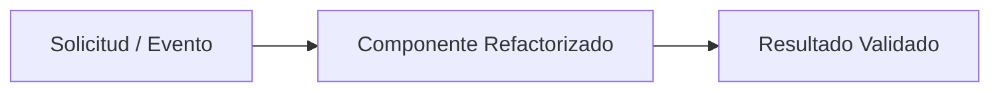

<context>
Estoy desarrollando el taller IncidentOps. En una conversación anterior exploré el cálculo de SLA y destilé las decisiones. Esta conversación debe trabajar exclusivamente con el contexto que incluyo aquí. Genera tu propuesta de forma independiente; la contrastaré localmente con pruebas.

El bloque siguiente corresponde al código original, antes de corregir el cálculo. La herramienta extrae AST y simula LSP; los decoradores e imports completos están en models_original.
<lsp_context symbol="evaluate_sla_status">
  <!-- 1. Definiciones de Tipos y Políticas (LSP Hover / Type Definition) -->
# [LSP textDocument/hover type] src/models.py:12
class SLARule:
    """Define el acuerdo de nivel de servicio (SLA) para un nivel de severidad."""

    severity: SeverityLevel
    max_resolution_minutes: int
    operates_24x7: bool
    escalation_threshold_ratio: float = 0.75

# [LSP textDocument/hover type] src/models.py:22
class Incident:
    """Representa un incidente registrado en la plataforma IncidentOps."""

    incident_id: str
    title: str
    component: str
    severity: SeverityLevel
    status: IncidentStatus
    created_at: datetime
    resolved_at: Optional[datetime] = None

# [LSP textDocument/hover type] src/models.py:35
class SLAEvaluation:
    """Resultado determinista de la evaluación de SLA de un incidente."""

    incident_id: str
    severity: SeverityLevel
    elapsed_minutes: int
    allowed_minutes: int
    remaining_minutes: int
    is_breached: bool
    requires_escalation: bool

# [LSP textDocument/hover type] src/models.py:48
class TriageResult:
    """Resultado estructurado producido por el clasificador de triaje con IA."""

    incident_id: str
    severity: SeverityLevel
    component: str
    rationale: str
    consistency_ratio: float = 1.0

# [LSP textDocument/hover symbol] src/sla_calculator.py:17
SLA_POLICY_TABLE: Dict[SeverityLevel, SLARule] = {
    "P0": SLARule(severity="P0", max_resolution_minutes=60, operates_24x7=True),
    "P1": SLARule(severity="P1", max_resolution_minutes=240, operates_24x7=True),
    "P2": SLARule(severity="P2", max_resolution_minutes=480, operates_24x7=False),
    "P3": SLARule(severity="P3", max_resolution_minutes=1440, operates_24x7=False),
}

  <!-- 2. Definición Exacta del Símbolo (LSP GoToDefinition) -->
# [LSP textDocument/definition] src/sla_calculator.py:25
def get_sla_rule_for_severity(severity: SeverityLevel) -> SLARule:
    """Obtiene la regla de SLA aplicable a una severidad validada contra la tabla."""
    if severity not in SLA_POLICY_TABLE:
        raise ValueError(f"Severidad no válida: {severity}")
    return SLA_POLICY_TABLE[severity]

# [LSP textDocument/definition] src/sla_calculator.py:32
def evaluate_sla_status(incident: Incident, reference_time: datetime) -> SLAEvaluation:
    """Evalúa si un incidente ha incumplido su SLA o requiere escalamiento preventivo.

    Args:
        incident: Entidad del incidente a evaluar.
        reference_time: Marca de tiempo actual o de cierre contra la cual medir.

    Returns:
        SLAEvaluation con los minutos transcurridos, restantes y banderas de estado.
    """
    rule = get_sla_rule_for_severity(incident.severity)
    end_time = incident.resolved_at or reference_time

    if end_time < incident.created_at:
        raise ValueError("El tiempo de referencia no puede ser anterior a la creación.")

    # TODO(week-1-taller): Cuando rule.operates_24x7 es False (P2 y P3), solo deben
    # contabilizarse los minutos dentro del horario hábil (Lunes-Viernes 08:00-18:00).
    delta_seconds = (end_time - incident.created_at).total_seconds()
    elapsed_minutes = int(delta_seconds // 60)

    remaining_minutes = rule.max_resolution_minutes - elapsed_minutes
    is_breached = elapsed_minutes > rule.max_resolution_minutes

    escalation_limit = int(rule.max_resolution_minutes * rule.escalation_threshold_ratio)
    requires_escalation = (
        incident.status != "RESOLVED"
        and not is_breached
        and elapsed_minutes >= escalation_limit
    )

    return SLAEvaluation(
        incident_id=incident.incident_id,
        severity=incident.severity,
        elapsed_minutes=elapsed_minutes,
        allowed_minutes=rule.max_resolution_minutes,
        remaining_minutes=remaining_minutes,
        is_breached=is_breached,
        requires_escalation=requires_escalation,
    )

  <!-- 3. Referencias de Invocación en el Proyecto (LSP FindReferences) -->
# [LSP textDocument/references] src/incident_repository.py:146
  L145:             )
  L146:             sla_eval = evaluate_sla_status(incident, reference_time=reference_time)
  L147:             results.append(

# [LSP textDocument/references] src/sla_calculator.py:87
  L86:     monday_morning = datetime(2026, 11, 9, 9, 0, 0)
  L87:     evaluation = evaluate_sla_status(sample_incident, reference_time=monday_morning)
  L88: 
</lsp_context>
<models_original>
"""Entidades de dominio y tipos de datos para IncidentOps."""

from dataclasses import dataclass
from datetime import datetime
from typing import Literal, Optional

SeverityLevel = Literal["P0", "P1", "P2", "P3"]
IncidentStatus = Literal["OPEN", "IN_PROGRESS", "ESCALATION_REQUIRED", "RESOLVED"]

@dataclass(frozen=True)
class SLARule:
    """Define el acuerdo de nivel de servicio (SLA) para un nivel de severidad."""

    severity: SeverityLevel
    max_resolution_minutes: int
    operates_24x7: bool
    escalation_threshold_ratio: float = 0.75

@dataclass
class Incident:
    """Representa un incidente registrado en la plataforma IncidentOps."""

    incident_id: str
    title: str
    component: str
    severity: SeverityLevel
    status: IncidentStatus
    created_at: datetime
    resolved_at: Optional[datetime] = None

@dataclass(frozen=True)
class SLAEvaluation:
    """Resultado determinista de la evaluación de SLA de un incidente."""

    incident_id: str
    severity: SeverityLevel
    elapsed_minutes: int
    allowed_minutes: int
    remaining_minutes: int
    is_breached: bool
    requires_escalation: bool

@dataclass(frozen=True)
class TriageResult:
    """Resultado estructurado producido por el clasificador de triaje con IA."""

    incident_id: str
    severity: SeverityLevel
    component: str
    rationale: str
    consistency_ratio: float = 1.0

</models_original>
<adr_template>
# ADR-000: [Título Corto de la Decisión Arquitectónica]

- **Estado**: Propuesto | Aceptado | Reemplazado
- **Fecha**: YYYY-MM-DD
- **Autor(es)**: [Nombre del Ingeniero / Equipo]
- **Componentes Afectados**: [`src/...`]

---

## 1. Contexto y Problema

Describe el problema técnico o de negocio actual, las limitaciones del código existente (por ejemplo, latencia, consultas N+1, errores de cálculo de SLA o limitaciones de escalabilidad) y las restricciones del sistema (p. ej., mantener cero dependencias externas, seguridad contra inyección SQL, determinismo).

---

## 2. Opciones Consideradas

1. **Opción A — [Nombre de la opción]**:
   - *Ventajas*: ...
   - *Desventajas*: ...
2. **Opción B — [Nombre de la opción]**:
   - *Ventajas*: ...
   - *Desventajas*: ...
3. **Opción C — [Nombre de la opción]**:
   - *Ventajas*: ...
   - *Desventajas*: ...

---

## 3. Decisión Arquitectónica

Explica claramente cuál opción fue elegida y **por qué**. Incluye un diagrama **Mermaid** (`flowchart TD`, `flowchart LR`, `sequenceDiagram` o `stateDiagram-v2`) que ilustre el diseño aprobado.

---

## 4. Consecuencias e Impacto

- **Positivas**: Mejoras en rendimiento, mantenibilidad, precisión o consumo de recursos.
- **Negativas / Trade-offs**: Complejidad adicional asumida o límites conocidos de la solución.
- **Verificación**: Cómo se comprobará empíricamente que la implementación cumple esta decisión.

</adr_template>
</context>
<decision_summary>
1. Conservar la firma y las entidades públicas del cálculo de SLA.
2. Para P0/P1 sumar tiempo continuo; para P2/P3 intersectar días laborables con [08:00,18:00).
3. Recorrer días con costo O(D) y memoria O(1); excluir fines de semana, no festivos.
4. Usar datetime sin zona bajo una única hora local de negocio; rechazar fechas con zona e intervalos invertidos.
5. Usar resolved_at como fin cuando exista; de lo contrario, reference_time.
6. Acumular segundos y truncar minutos una sola vez para los campos públicos.
7. Incumplir únicamente cuando el tiempo exacto supera el plazo; la igualdad no incumple.
8. Escalar un incidente no resuelto desde el 75% y mantener el escalamiento al vencer.
9. No escalar cuando status sea RESOLVED o exista resolved_at.
10. Descartar el recorrido minuto a minuto y fórmulas semanales más complejas; verificar bordes y compatibilidad.
</decision_summary>
<constraints>
Python 3.10 o superior, biblioteca estándar, sin dependencias adicionales.
Mantén las firmas públicas y los campos de Incident, SLARule y SLAEvaluation.
P0: 60 minutos 24/7; P1: 240 minutos 24/7; P2: 480 minutos hábiles; P3: 1440 minutos hábiles.
Horario hábil: lunes a viernes, 08:00 a 18:00. Sin festivos adicionales.
Mantén los límites de alcance y contrato temporal del resumen. Si detectas una contradicción, explícala antes de implementar.
El diagrama debe utilizar Mermaid flowchart TD y distinguir horario continuo, horario hábil y escalamiento.
La justificación debe ser breve y comprobable. No necesito razonamiento interno detallado.
</constraints>
<task>
Entrega primero el ADR completo docs/adr/002-calculo-sla-horario-habil.md, siguiendo la plantilla y el resumen de decisiones.
Después entrega src/sla_calculator.py completo, con una demostración ejecutable y comprobaciones que terminen con error si fallan.
Incluye al menos estos resultados esperados:
P2 viernes 2026-11-06 17:00 a lunes 2026-11-09 09:00: 120 minutos.
P2 viernes 18:30 a lunes 08:30: 30 minutos.
P2 sábado 2026-11-07 10:00 a lunes 08:30: 30 minutos.
P3 sábado a domingo: 0 minutos.
P3 lunes 08:00 a 18:00: 600 minutos.
P1 sábado 10:00 a 13:00: 180 minutos y escalamiento activo.
P2 lunes 08:00 a 14:00: 360 minutos y escalamiento activo.
P2 lunes 08:00 a 16:01: 481 minutos, vencido y escalamiento activo.
P0 exactamente 60 minutos: no vencido, escalamiento activo.
P0 a 60 minutos y 1 segundo: vencido, escalamiento activo.
Incidente resuelto: no requiere escalamiento y resolved_at detiene el reloj.
Explica las limitaciones y los comandos de verificación. Distingue resultados esperados de pruebas efectivamente ejecutadas.
</task>
