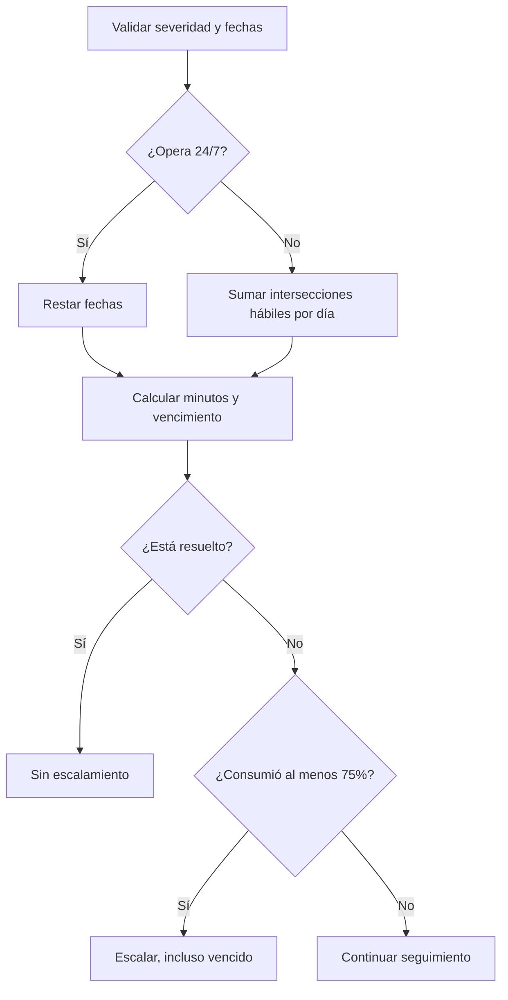

ADR-002: Cálculo de SLA en horario hábil y escalamiento

Estado: Aceptado para la implementación local del taller
Fecha: 2026-11-17
Autor: Alvaro, con asistencia de IA
Componentes afectados: src/sla_calculator.py

1. Contexto y problema

Encontré que el cálculo descontaba tiempo calendario para todas las severidades. Un P2 creado el viernes a las 17:00 y evaluado el lunes a las 09:00 consumía 3.840 minutos cuando correspondían 120. Además, el escalamiento preventivo se apagaba después de vencer el SLA por la condición not is_breached.

Conservo la política: P0 permite 60 minutos y P1 240, ambos 24/7; P2 permite 480 y P3 1.440 minutos hábiles. La jornada hábil es de lunes a viernes, de 08:00 a 18:00. No incorporo festivos porque no están definidos en el enunciado.

2. Opciones consideradas

Resta continua de fechas: es simple y O(1), pero solo resuelve correctamente P0 y P1.
Recorrido minuto a minuto: facilita una comprobación independiente, pero su costo O(M) crece con cada minuto del intervalo.
Intersección por jornadas: recorre cada día y acumula únicamente el tramo compartido con la jornada laboral. Tiene costo O(D) y memoria O(1).
Cálculo por semanas completas: puede reducir el costo de intervalos extensos, pero aumenta la complejidad de bordes y no es necesario para el taller.

3. Decisión arquitectónica

Elegí la intersección por jornadas para P2 y P3 y la resta continua para P0 y P1. Uso el intervalo [08:00,18:00), por lo que las 18:00 no agregan tiempo a la jornada siguiente. Una jornada completa suma 600 minutos.

El tiempo final es resolved_at cuando existe y reference_time en los demás casos. Valido el intervalo efectivo entre creación y cierre o referencia. Rechazo intervalos invertidos y fechas efectivas con zona horaria explícita. Si resolved_at existe, reference_time no participa en el cálculo ni en la validación. Los datetime sin zona representan una única hora local de negocio, como en el JSON original. La conversión de zonas queda fuera del contrato de este taller.

Acumulo timedelta exactos de todas las intersecciones y después trunco los minutos para conservar el tipo entero de elapsed_minutes. Comparo los umbrales contra los segundos exactos. A igualdad del plazo no hay incumplimiento; un segundo después sí lo hay. Por compatibilidad, remaining_minutes conserva la diferencia entre minutos permitidos y minutos completos consumidos y puede ser negativo. A un segundo de vencimiento puede mostrar cero aunque is_breached sea verdadero.

Un incidente no resuelto requiere escalamiento desde el 75% del plazo, incluso cuando ya esté vencido. Considero resuelto un incidente con status RESOLVED o con resolved_at definido. Si status indica resolución pero no hay fecha de cierre, uso reference_time para medir, conservo el comportamiento original y no activo escalamiento; ese registro requiere completar su fecha de cierre.

4. Consecuencias e impacto

Corrijo la precisión del tiempo hábil y evito que desaparezca el escalamiento al vencer el acuerdo. Mantengo firma, entidades y dependencias estándar. El algoritmo es determinista y no requiere un modelo en ejecución.

Acepto costo lineal por días y excluyo festivos y conversión de zonas. El cálculo no modifica el estado del incidente ni envía notificaciones: devuelve requires_escalation para que otra capa active el protocolo.

5. Verificación

Verifico cruces de fin de semana, creación en sábado, inicio fuera de jornada, varios fines de semana, límites de 08:00 y 18:00, jornadas completas, P0/P1 en fin de semana, umbral del 75%, igualdad y superación del plazo, resolución e intervalos inválidos. Una prueba independiente recorre minutos de intervalos alineados y contrasta el acumulado con el algoritmo diario. También pruebo fracciones de minuto a través de dos jornadas.

Comandos:
uv run python -m src.sla_calculator
uv run python -m unittest discover -s tests -v

Las salidas efectivas se conservan en evidencias; este ADR no sustituye la ejecución de esas pruebas.

6. Contraste con el chat limpio

Revisé el ADR y el código recibidos de la conversación limpia. Coincidieron con el diseño diario y el escalamiento persistente. Incorporé la acumulación exacta mediante timedelta y la validación exclusiva del intervalo efectivo. Conservé la demostración local con comprobaciones explícitas, que no desaparecen al ejecutar Python con optimizaciones. Las propuestas originales quedan en evidencias/chat-limpio-sla.
