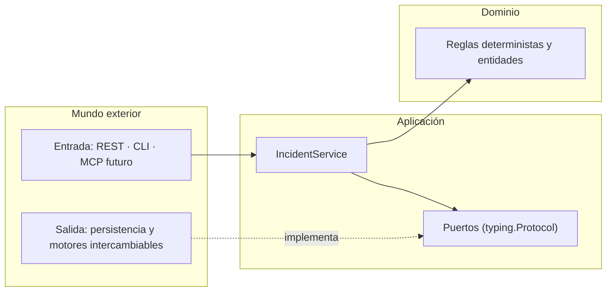

# ADR-003: Adopción de Arquitectura Hexagonal (Puertos y Adaptadores) para IncidentOps
- **Estado**: Aceptado
- **Fecha**: 2026-11-21
- **Autor(es)**: Alvaro
- **Reemplaza a**: Ninguno
---
## 1. Contexto y Problema
Las reglas deterministas de triaje y SLA conviven hoy con demostraciones ejecutables, carga de datos y un repositorio que consulta la evaluación de SLA directamente. La evolución prevista añade nuevos canales de consumo, persistencia del ciclo de vida, motor de datos dedicado y ejecución en contenedores. Sin una frontera explícita, las elecciones de entrega y almacenamiento se filtrarán al núcleo de reglas y serán difíciles de revertir. La decisión es separar ese núcleo de los mecanismos de entrada y salida mediante puertos. Restricciones vigentes: conservar el comportamiento ya verificado, mantener las reglas libres de dependencias de infraestructura, preservar la compatibilidad de las entidades públicas y no introducir inferencia en tiempo de ejecución.
---
## 2. Opciones Consideradas
1. **Opción A — Capas tradicionales acopladas a un único stack web/base de datos**:
- *Ventajas*: Menos indirección y menor esfuerzo inicial; el flujo desde la interfaz hasta la persistencia es directo y fácil de seguir mientras exista un solo canal y un solo motor.
- *Desventajas*: Los cambios de framework, de canal o de motor de datos alcanzan a la lógica de reglas; las pruebas del núcleo quedan atadas a infraestructura; el acoplamiento se vuelve progresivamente más costoso de deshacer.
2. **Opción B — Arquitectura Hexagonal con puertos y adaptadores**:
- *Ventajas*: Las dependencias apuntan hacia el núcleo; las reglas deterministas quedan aisladas de entrega y persistencia; canales como REST, CLI y un futuro MCP, así como motores de datos intercambiables, se incorporan como adaptadores sin alterar las reglas; la adopción puede ser incremental sobre los módulos actuales.
- *Desventajas*: Más capas e indirección; exige estabilizar puertos que definen límites duraderos; puede caer en sobre-ingeniería si el proyecto no llega a tener varios canales o motores.
---
## 3. Decisión Arquitectónica
Elegimos la Opción B. El valor está en proteger el núcleo determinista frente a decisiones que el roadmap aún no fija —canales de consumo y motor de datos— y que, tomadas dentro de las reglas, serían difíciles de revertir. La separación permite incorporar esos cambios en los bordes y migrar desde el código actual sin redefinir el comportamiento ya verificado.

La estructura prevista distingue `src/domain/` para entidades y reglas puras; `src/application/` para `IncidentService` y los puertos definidos con `typing.Protocol`; y `src/adapters/inbound/` y `src/adapters/outbound/` para REST, CLI, futuro MCP y motores de persistencia intercambiables.

Las dependencias apuntan hacia el centro: el dominio no conoce a la aplicación ni a los adaptadores.
---
## 4. Consecuencias y Trade-offs
- **Positivas**: El núcleo de reglas queda desacoplado de canales y almacenamiento; cambiar o añadir adaptadores no obliga a reescribir las reglas; la verificación del dominio deja de depender de infraestructura; la portabilidad del servicio mejora al concentrar las decisiones de entorno en los bordes.
- **Negativas / Trade-offs**: Se asume complejidad estructural y una capa de indirección; los puertos deben diseñarse con cuidado porque fijan límites difíciles de cambiar después; cada adaptador añade mantenimiento; la composición y configuración del servicio pasan a ser una responsabilidad explícita del borde.
