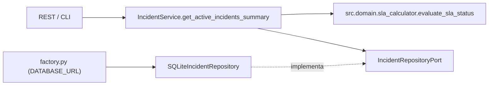

# ADR-004: Ampliación del puerto de persistencia para el resumen de incidentes
- **Estado**: Aceptado
- **Fecha**: 2026-11-21
- **Autor(es)**: Alvaro
- **Reemplaza a**: Ninguno
- **Relacionados**: ADR-001 (SQLite3 sin ORM), ADR-002 (SLA en horario hábil), ADR-003 (Arquitectura Hexagonal)
---
## 1. Contexto y Problema
ADR-003 fijó `IncidentRepositoryPort` como frontera entre la aplicación y la persistencia, pero el puerto actual solo declara una operación de resumen que devuelve diccionarios y calcula SLA dentro del adaptador SQLite heredado. El Hito 002 necesita consultar incidentes activos desde REST y CLI, sembrar datos en pruebas aisladas y comprobar la salud del repositorio sin que los adaptadores primarios conozcan SQL ni repositorios concretos. La Constitución exige un ADR previo para cualquier cambio de puerto; por tanto, la ampliación debe decidirse y aceptarse antes de modificar `src/application/ports.py`.

Restricciones vigentes: las reglas de SLA permanecen en `src.domain.sla_calculator`; la persistencia sigue siendo SQLite3 estándar sin ORM (ADR-001); los adaptadores primarios delegan en un único caso de uso de aplicación; los `datetime` son naive; el repositorio legado y sus evidencias didácticas no se reescriben.
---
## 2. Opciones Consideradas
1. **Opción A — Conservar el puerto actual y mantener el cálculo de SLA en el adaptador SQLite**:
   - *Ventajas*: Menos cambios inmediatos; reutiliza el método heredado sin tocar la interfaz.
   - *Desventajas*: Duplica la regla de SLA en SQL y en Python; el adaptador devuelve diccionarios sin tipado de dominio; la aplicación no puede ser probada con un repositorio en memoria sin arrastrar SQLite; contradice ADR-002 y la Constitución I.
2. **Opción B — Ampliar el puerto con operaciones de persistencia y devolver entidades de dominio**:
   - *Ventajas*: La aplicación orquesta un único caso de uso compartido; el dominio sigue siendo la única fuente de SLA; las pruebas siembran con `save_incident` sobre una BD en memoria; `factory.py` sigue siendo el único punto de construcción; el repositorio optimizado puede sustituir al legado sin tocar REST ni CLI.
   - *Desventajas*: La interfaz es más amplia que el mínimo estricto del Hito 002; `find_open_duplicates` anticipa trabajo del Hito 003; exige verificar conformidad estructural porque los *stubs* heredados pueden dar falsos positivos con `isinstance`.
---
## 3. Decisión Arquitectónica
Elegimos la Opción B. `IncidentRepositoryPort` pasa a declarar cinco operaciones: `save_incident`, `get_incident`, `find_open_duplicates`, `list_active_incidents` y `check_health`. Se retira `get_active_incidents_summary`: el puerto expone persistencia, no reglas de negocio. `list_active_incidents` devuelve entidades `Incident` del dominio, filtradas por estados `OPEN`/`IN_PROGRESS`, ordenadas por identificador y con `None` como representación de «sin filtro».

`IncidentService.get_active_incidents_summary` aplica `evaluate_sla_status` sobre esas entidades y construye el agregado. El servicio normaliza `component_filter` (ausente, vacío o solo espacios → `None`) y aplica el default `reference_time = datetime.now()`; los adaptadores solo traducen parámetros de transporte y validan el formato ISO naive. La conformidad es estructural (`@runtime_checkable`) y se comprueba con `isinstance` sobre el objeto real, sin herencia explícita del `Protocol`.

La implementación concrete es `SQLiteIncidentRepository` en `src/adapters/outbound/sqlite_repository.py`, construida por `src.adapters.outbound.factory` desde `DATABASE_URL` con default `sqlite:///:memory:`. El repositorio legado `src/adapters/outbound/incident_repository.py` permanece intacto como artefacto didáctico.

### Diagrama de flujo

---
## 4. Consecuencias y Trade-offs
- **Positivas**: El núcleo determinista permanece intacto; el resumen es verificable con repositorios en memoria; REST y CLI comparten el mismo caso de uso y la misma respuesta; el motor de persistencia puede sustituirse sin cambiar adaptadores primarios; se preservan el benchmark y las evidencias de Semana 1.
- **Negativas / Trade-offs**: El puerto incluye operaciones que H002 no invoca; la validación de formato de fecha vive en los bordes y exige paridad entre HTTP y CLI; la comprobación `isinstance` depende de que las clases concretas no hereden del `Protocol`.
- **Requisitos de verificación**: `uv run ruff check src/` con reglas jerárquicas por capa, incluido `src/adapters/outbound/ruff.toml` que permite `sqlite3` solo en la capa de salida; 4 escenarios BDD mapeados 1:1 a `test_bdd_*`; comprobación de conformidad del puerto y pruebas de fecha inválida fuera de los 4 BDD.
---
## 5. Notas
 Esta decisión actualiza la Constitución v1.1.0 a v1.2.0: el principio III pasa a referirse a «el mismo caso de uso de `IncidentService`» en lugar de nombrar exclusivamente `triage_incident`, y las decisiones registradas añaden este ADR a los cambios de puerto ya cubiertos.
