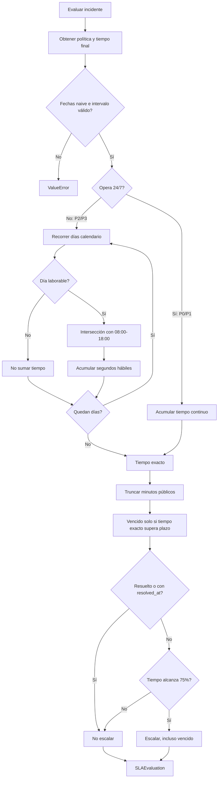

# ADR-002: Cálculo determinista de SLA con horario hábil

- Estado: Aceptado
- Fecha: 2026-11-17
- Autor(es): Equipo de Ingeniería IncidentOps
- Componentes Afectados: `src/sla_calculator.py`
- Interfaces conservadas: `src/models.py`, `src/incident_repository.py`

## 1. Contexto y Problema

La implementación original de `evaluate_sla_status(incident, reference_time)` calcula el tiempo continuo para todas las severidades e ignora `SLARule.operates_24x7`. Esto contabiliza erróneamente noches y fines de semana para P2/P3. Además, la condición `not is_breached` desactiva el escalamiento después de vencer el SLA, contrario a la política aprobada.

| Severidad | Plazo | Modalidad |
|---|---:|---|
| P0 | 60 minutos | 24/7 |
| P1 | 240 minutos | 24/7 |
| P2 | 480 minutos | Hábil |
| P3 | 1440 minutos | Hábil |

El horario hábil es lunes a viernes `[08:00,18:00)`; no se excluyen festivos. Restricciones: Python 3.10+, solo biblioteca estándar, firmas y campos públicos intactos, determinismo, fechas naive de una misma hora local de negocio, rechazo de intervalos invertidos, O(D) tiempo y O(1) memoria en cálculo hábil.

## 2. Opciones Consideradas

1. Opción A — Recorrido minuto a minuto.
   - Ventajas: lógica sencilla por minuto.
   - Desventajas: O(M) tiempo, ineficiente en intervalos largos y sin necesidad de granularidad por minuto.
2. Opción B — Intersección diaria de intervalos.
   - Ventajas: O(D) tiempo, O(1) memoria, precisión a nivel de `timedelta`, auditable, sin dependencias.
   - Desventajas: lógica de límites por día; costo lineal en días calendario.
3. Opción C — Fórmulas aritméticas semanales.
   - Ventajas: posibilidad de reducir iteraciones para intervalos extensos.
   - Desventajas: mayor complejidad, más casos límite, mantenimiento menos directo.

## 3. Decisión Arquitectónica

Se adopta la opción B. P0/P1 acumulan tiempo continuo; P2/P3 acumulan las intersecciones de cada día laborable con `[08:00,18:00)`. `resolved_at` determina el final si existe; en otro caso, `reference_time`. Solo se valida el intervalo temporal efectivo. Se rechazan fechas aware e intervalos invertidos. El tiempo se acumula exactamente como `timedelta`, truncando minutos una sola vez para los campos públicos. `is_breached` se activa solo cuando el tiempo exacto supera el plazo (igualdad no vence). El escalamiento comienza al 75%, persiste tras el vencimiento y se desactiva si `status == "RESOLVED"` o existe `resolved_at`.

Se conservan `SLA_POLICY_TABLE`, `get_sla_rule_for_severity`, `evaluate_sla_status` y todos los campos de `Incident`, `SLARule`, `SLAEvaluation`. Los auxiliares son privados.



## 4. Consecuencias e Impacto

- Positivas: cálculo hábil correcto para P2/P3, precisión en límites por segundo, escalamiento persistente, determinismo, compatibilidad pública, cero dependencias nuevas.
- Negativas / Trade-offs: horario fijo sin festivos, sin zonas horarias ni conversiones, O(D) según días calendario, campos públicos truncados pueden mostrar el límite en minutos aunque exista incumplimiento por segundos.
- Verificación: ejecutar escenarios viernes-lunes, fin de semana, jornada completa, umbral del 75%, vencimiento exacto y un segundo posterior, incidentes resueltos, prioridad de `resolved_at`, errores por fechas aware e intervalos invertidos y severidad inválida.

Comandos desde la raíz del proyecto:

```bash
python -m src.sla_calculator
python -m compileall -q src
```

Criterio de aceptación: todos los `assert` deben cumplirse; cualquier discrepancia produce una excepción y salida no exitosa. La ejecución real debe distinguirse de los resultados esperados.
